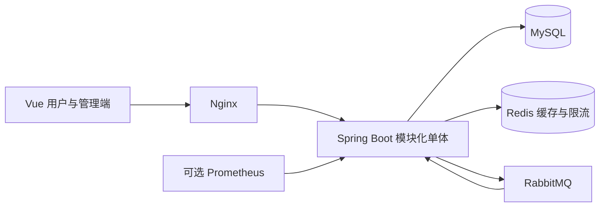

# FlashSlot 当前设计

更新于 2026-10-17。本文描述已实现的模块、数据一致性与故障边界；接口字段和错误码见[后端说明](../flashslot/README.md)，部署方法见[部署说明](../deploy/flashslot/README.md)。

## 模块与部署形态

FlashSlot 是模块化单体：一个 Spring Boot 应用、一套 MySQL 数据库，前端由 Nginx 提供静态资源并同源代理 API。按 auth、resource、booking、waitlist、credit、messaging、operations 分包，不使用 Nacos 或 Feign。

将预约、占用、配额和候补留在同一应用与数据库，便于在一个本地事务中保证业务完整性。当前没有证明需要拆分微服务的容量数据；单独拆进程而共享数据库，仍需协调跨模块锁与事务，无法自动获得业务解耦。

## 关键业务规则

- 业务日期按 Asia/Shanghai，时间点用 UTC Instant / DATETIME(3)。一格 30 分钟，区间左闭右开。
- 每台设备每天一个连续开放区间。后台维护今天起 14 天日历，只补缺失行；用户只能申请今天起 7 天内的时段。
- 创建预约须满足提前 30 分钟、连续时段、单次最多 8 格、同一用户每天跨设备合计最多 8 格；同一用户跨设备不能重叠。
- 普通用户发起个人预约；管理员维护账号、设备、日历与异常任务，不提供管理员个人预约入口。
- 签到窗口为开始前 10 分钟至开始后 15 分钟，需要现场有效短时签到码。逾期结算爽约并变更信用；具体结算与限制规则见后端说明。
- PAUSED 禁止新申请及候补转正，已有订单按原生命周期处理；RETIRED 为终态，退役前校验业务占用。

## 数据库与事务边界

当前为 16 张表，迁移版本 V1–V10。[Flyway 迁移](../flashslot/src/main/resources/db/migration)是应用升级入口；[db/](../db/README.md)用于独立手工建库和结构验证，不能对同一个 Flyway 库重复执行。

设备格占用使用 `(resource_id, book_date, slot_index)` 联合主键；用户格占用使用 `(user_id, book_date, slot_index)` 联合主键。唯一约束负责拒绝重复占用，不能代替权限、开放区间、业务状态与跨表归属校验。

创建预约在同一个事务内完成幂等准备、设备与日期锁、用户配额校验、订单、多格占用和 Outbox 写入。多格写入使用普通批量 INSERT，冲突整体回滚，不使用 INSERT IGNORE。

锁序由业务统一约束：资源与日期 → 对应订单/候补/任务 → 按规则锁定用户 → 业务明细。外键取得的父表锁同样属于锁序设计。预约、取消、候补转正和设备状态变更不能各自使用任意顺序。

取消与提前结束只返还未开始格。没有有效可承接候补时，原事务直接释放未来设备格并留下 RELEASED 记录；有候补时才进入 HANDOFF。释放必须匹配精确订单或任务身份，不能只按用户删除。

## 请求幂等与重试

`api_idempotency` 参与业务事务，绑定用户、操作、幂等键与请求哈希。相同请求可回放首次结果，换参数返回 IDEMPOTENCY_CONFLICT。

明确业务拒绝可保存为首次结果；暂时性 5xx 不固化缓存。锁冲突先完整回滚，返回 503，前端保留原键供用户重试。旧版 CALENDAR_NOT_READY 缓存经过请求哈希核对后重新评估。

前端不自动重放写请求。网络/5xx 后保留原键，参数变化使用新键；公开查询通过 generation 隔离旧响应。排期七天窗口在上海午夜和页面重新可见时更新。

## 认证与模拟注册

手机号注册固定创建 USER，注册和自动登录在同一事务；用户名、手机号唯一索引兜底并发。密码 BCrypt cost 12；JWT 使用固定算法、签发方和受众。每次认证查数据库凭据版本和撤销记录，停用或改密使旧 Token 失效，不再维护 Redis 封禁缓存。

当前演示站显式开启手机号模拟注册：六位验证码返回前端显示，不发送真实短信，也不证明手机号归属。验证码指纹和 TTL 存 Redis；同号 60 秒冷却、每 24 小时 10 次、来源 IP 每小时 60 次，输错 5 次失效。

登录另有来源 IP 30 次/分钟、账号 5 次/分钟的共享固定窗口计数。只信任明确配置的代理提供单个合法 X-Real-IP；Redis 不可用时登录限流降级为本实例内存保护。验证码服务不可用则拒绝注册。

应用默认 production；模拟注册通过显式开关开启，Swagger 只在 local 开放。首个管理员用[独立 JDBC CLI](admin-bootstrap.md)初始化，已有 ADMIN 时拒绝重复初始化。

## 缓存

排期缓存键包含设备、日期和数据库 revision。预约、取消、转正、日历调整提交时增加 revision，后续查询使用新键；迟到的旧查询只会回填旧键，不覆盖新版本。

缓存只保存公开占用，用户本人的订单标记由当前快照补充。开放状态与截止规则仍按当前数据库和服务器时间判断。Redis 故障可回源；Redisson 只协调缓存重建，不能代替数据库唯一约束或事务。

## 异步消息与恢复

业务事件先在原事务写 Outbox。发布器使用租约、有限重试与 broker confirm，只有确认并成功写回状态才标记 PUBLISHED。通知和 RELEASE_DISPATCHED 分别路由到消费者，Inbox 与业务约束防重复执行。

取消产生待撮合任务时，同事务写入派发事件，撮合秒级开始；每分钟补偿扫描为没有在途派发的到期任务补派。设备恢复时，按设备版本为待处理任务同事务写入新的唤醒事件，避免被旧消息冷却或同分钟去重挡住。处理遵守任务状态、退避、人工复核与 PAUSED 限制；自动撮合在 RabbitMQ 故障期间可能延迟。

### 为什么下单不走 MQ

创建预约保持同步事务：用户需要立即知道是否约上，失败原因（冲突、配额、截止）必须当场返回；库存是每台设备每天 48 个时间格，行锁与唯一约束足以承载并发。排队下单适合秒杀类“先受理、后通知”的场景，在这里会让用户等待异步结果并增加补偿复杂度。MQ 只用于下单之后的异步副作用：通知和候补撮合。

消费重试耗尽后先在数据库保存原文和受控来源/失败分类，再允许 ACK；落库失败则退避重投。管理员列表不返回原文，恢复与审计、幂等状态按对应业务事务提交。

无订阅的已登记留痕事件直接 ARCHIVED，默认保留 90 天并分批清理。未登记类型拒绝写入，避免拼写错误静默归档。PUBLISHED/Inbox 保留以维护防重，长期容量策略尚需另行设计。

## 可观测性与证据边界

[消息指标](message-metrics.md)覆盖发布/消费 Counter、Timer，积压、死信、释放任务和快照可用性 Gauge。解析拒绝同样计入消费失败；数据库快照失败返回 NaN，不伪装成空积压。

Prometheus 配置与五条告警规则已通过 promtool 校验，服务器已验证授权私网抓取。可选 Prometheus 容器未启用，未接外部通知。当前为单机 HTTP 演示，不宣称高可用、生产容量、真实手机号验证或已完成备份恢复演练。
